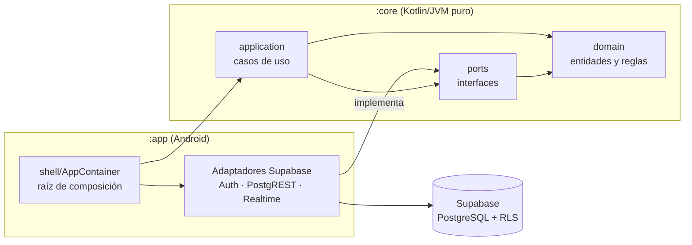

# Robot Centinela: aplicación móvil (Android)

Este repositorio contiene la app Android del proyecto **Robot Centinela**, un rover doméstico que
monitorea gases y navega en dos dimensiones: el **backend en Kotlin** (dominio, casos de uso y
adaptadores de datos) y una **propuesta de frontend en Jetpack Compose** basada en la guía de
interfaces *Lunar Base* (ver [docs/ui/interfaz-movil.md](docs/ui/interfaz-movil.md)).

La app es de **consulta**. Lee de Supabase la telemetría y las alertas del robot que la ingesta
persistió. **No controla el robot**: el inicio, la pausa y la parada son locales y el firmware es la
autoridad de seguridad (expediente §1, §7.1). Tampoco calcula alertas: **la lógica de alertas, los
umbrales y la histéresis viven en la base de datos**. La app solo los lee.

> **Estado:** Implementación completa del frontend y backend en Android con Jetpack Compose y
> arquitectura hexagonal. Conectada al backend real en Supabase (telemetría, incidentes,
> misiones y autenticación mediante Supabase Auth). Contratos no publicados por el servidor (mapas
> vectoriales en Storage y comandos remotos) cuentan con manejo de degradación elegante y avisos
> explícitos al usuario.

## Alcance de esta versión

| Incluido | Historias |
|---|---|
| Inicio y cierre de sesión con Supabase Auth, recuperación de acceso y selección explícita del domicilio | HU01, RF01, RF02 |
| Semántica de lecturas: señal cruda sin calibrar (nunca ppm), "No instalado", "Sin dato" (nunca 0), calentando, fallo, fuera de rango | HU02, HU20 |
| Sincronización en vivo por `stream_version`: snapshot, deltas, reconexión y reconciliación | HU03 |
| Edad del dato por canal y paso a "atrasado" | HU04 |
| Historial de frames y alertas con filtro de fechas local convertido a UTC | HU07 |
| Batería con método ("Porcentaje no disponible" si solo hay voltaje) | HU08 |
| Pose con incertidumbre e IDs de mapa y misión (sin geometría de mapa) | HU05, HU06 (parcial) |
| Fixtures sintéticos de prueba | HU15 (parcial) |
| Interfaz Compose según los mockups móviles: Pantalla de Login, Resumen, Mapa, Misiones, Historial, Eventos y Ajustes con tema claro/oscuro y Poppins | HU01 a HU08, HU12, HU20 |
| Plano por versión de mapa y resumen de misión: contratos provisionales en `:core`, la interfaz muestra estado informativo en ausencia de archivo | HU05, HU06, HU08 |

**Fuera de esta versión:** las calibraciones
detalladas, la exportación CSV, push, video y comandos. La trazabilidad completa está en
[docs/requirements/trazabilidad.md](docs/requirements/trazabilidad.md).

## Arquitectura

Arquitectura **hexagonal** (puertos y adaptadores) organizada por dominios (*Screaming
Architecture*, expediente §14). Las dependencias apuntan hacia el negocio.



- **`:core`** no depende de Android, Supabase ni Ktor. El compilador lo garantiza porque el módulo
  no declara esas dependencias.
- **`:app`** implementa los puertos con [supabase-kt](https://github.com/supabase-community/supabase-kt)
  y conecta todo en `AppContainer` (DI manual).

Detalle: [docs/architecture/arquitectura-hexagonal.md](docs/architecture/arquitectura-hexagonal.md) ·
Sincronización: [docs/architecture/sincronizacion-telemetria.md](docs/architecture/sincronizacion-telemetria.md)

## Estructura

```
core/src/main/kotlin/com/robotcentinela/app/
  telemetry/                frame, stream_version, sincronización, historial
  environmentalmonitoring/  lecturas, calidad, frescura, capacidades, agregados
  robothealth/              batería, estado reportado, ingesta
  homemapping/              pose, versión de mapa
  missions/                 identificador de misión
  incidents/                alertas leídas de la base de datos
  identity/                 sesión, membresías, ámbito de domicilio
  shared/                   intervalo UTC, paginación, errores
app/src/main/kotlin/com/robotcentinela/app/
  <dominio>/adapters/supabase/   implementaciones de los puertos
  shell/                         CentinelaApplication, AppContainer, Adapters
  shell/supabase/                cliente, configuración y nombres de recursos (provisionales)
  ui/                            interfaz Compose: tema, componentes, pantallas y ViewModels
  ui/model/                      reglas de presentación sin Android (textos, estados, formatos)
docs/                       arquitectura, diccionario de datos, trazabilidad, decisiones, pendientes
```

## Requisitos

- JDK 21.
- Android SDK con la plataforma 37 (`compileSdk` 37, `targetSdk` 36, `minSdk` 29). Compose 1.12,
  Lifecycle 2.11 y Navigation 2.10 se publican compilados con API 37.
- Gradle 9.6.0, incluido mediante el wrapper (`./gradlew`).

## Configuración

Las credenciales se leen de `local.properties`, que **no se versiona**. Copia
`local.properties.example` como `local.properties` y completa estas variables:

| Variable | Descripción |
|---|---|
| `sdk.dir` | Ruta al Android SDK. |
| `supabase.url` | URL **HTTPS** del proyecto Supabase. |
| `supabase.publishableKey` | Clave **pública** del cliente (anon o publishable). |

La app **rechaza** claves privilegiadas (`service_role` o `sb_secret_...`): nunca deben llegar al
teléfono (expediente §7.3, RNF08). Sin configuración, la app compila y arranca, y el error aparece
con un mensaje claro al usar el backend por primera vez.

## Comandos

```bash
./gradlew :core:test               # pruebas del dominio y casos de uso (JVM)
./gradlew :app:testDebugUnitTest   # pruebas de adaptadores: contrato JSON y configuración
./gradlew assembleDebug            # APK de depuración
```

## Documentación

| Documento | Contenido |
|---|---|
| [docs/architecture/arquitectura-hexagonal.md](docs/architecture/arquitectura-hexagonal.md) | Capas, puertos, adaptadores y regla de dependencias |
| [docs/architecture/sincronizacion-telemetria.md](docs/architecture/sincronizacion-telemetria.md) | Algoritmo snapshot, deltas y watermark |
| [docs/data_dictionary/frame-telemetria-v1.md](docs/data_dictionary/frame-telemetria-v1.md) | Diccionario del frame (`JSON_estructura.txt`) |
| [docs/requirements/trazabilidad.md](docs/requirements/trazabilidad.md) | HU, RF y RB, con su código, pruebas y estado |
| [docs/decisions/](docs/decisions/) | Registro de decisiones de arquitectura (ADR) |
| [docs/pendientes.md](docs/pendientes.md) | Preguntas abiertas para backend, IoT e Ingeniería de Software |
| [docs/ui/interfaz-movil.md](docs/ui/interfaz-movil.md) | Interfaz móvil: pantallas, conexión con el backend, tokens y accesibilidad |

La documentación de origen del proyecto (expediente técnico, historias de usuario y estructura JSON)
está en `Documentacion-original/`, que se usa localmente y no se versiona.

## Licencia

GPL-3.0. Ver [LICENSE](LICENSE).
