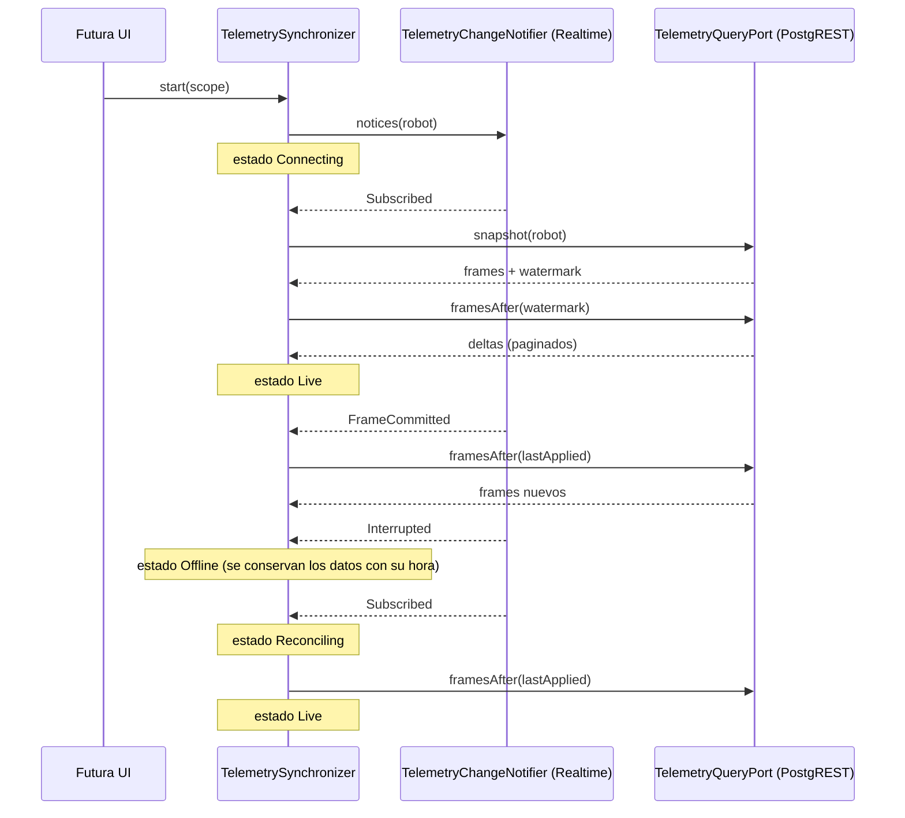

# Sincronización de telemetría

Implementación: `core/.../telemetry/application/TelemetrySynchronizer.kt`
Pruebas: `core/src/test/.../telemetry/application/TelemetrySynchronizerTest.kt`
Origen: expediente §7.4, RF07, RF08, RB19, RB26 a RB28 y casos de prueba T02, T07 y T08.

## Principios

1. **Realtime avisa, no transporta.** Un aviso de Realtime solo indica que hay frames confirmados.
   Los datos se piden siempre con consultas persistidas (RB26). Realtime no es una cola durable.
2. **`stream_version` ordena.** El backend lo asigna por robot dentro de la transacción del frame y
   lo incrementa de uno en uno (§7.4, §13.6). La app nunca aplica una versión menor o igual a la
   última aplicada, así que no retrocede ni duplica.
3. **Un frame atrasado entra al historial, pero no reemplaza el dato actual** (RB19). Eso lo decide
   `LatestTelemetryProjection` con este criterio:
   - mismo boot: manda `sequence`;
   - boots distintos con reloj sincronizado: manda `captured_at`;
   - en otro caso: se usa `received_at` y la hora queda marcada como aproximada.

## Secuencia

## Casos especiales

| Situación | Comportamiento |
|---|---|
| Un aviso llega antes de la respuesta HTTP | Los avisos se agrupan y solo disparan consultas desde `lastAppliedVersion`. No hay retroceso |
| Entrega duplicada (QoS 1 o reintentos) | Se descarta por `stream_version` y por `frame_id` (ventana de 2,700 IDs, §7.5) |
| Hueco en el cursor: el primer delta es mayor que `lastApplied + 1` | Los frames intermedios se eliminaron por retención. Se aplica un snapshot completo y se marca `historyLimited` (T08) |
| No llegan avisos | Reconciliación periódica cada 30 s, valor inicial de §7.4 |
| Falla una consulta | Estado `Error`. Se reintenta con el siguiente aviso o en la siguiente reconciliación |
| Frame que no cumple el contrato | Llega como `FrameRecord.Rejected`: avanza el cursor y se cuenta en `rejectedFrames` (RF29) |
| App en segundo plano | La UI llama a `stop()` y el estado pasa a `Stopped`, nunca "en vivo" (RB28). Con `start()` se reconcilia |
| El flujo de avisos termina | Se reintenta la suscripción tras el intervalo de reconciliación |

## Estados

| `SyncStatus` | Significado |
|---|---|
| `Idle` | No iniciado |
| `Connecting` | Primera conexión: se esperan la suscripción y el snapshot |
| `Reconciling` | Recuperando deltas tras reconexión o regreso a primer plano |
| `Live` | Suscrito y al día |
| `Offline(reason)` | Suscripción interrumpida |
| `Error(message)` | Falló una consulta |
| `Stopped` | Detenido (segundo plano) |

## Parámetros (ADR-004)

| Parámetro | Valor inicial | Origen |
|---|---|---|
| `reconciliationInterval` | 30 s | §7.4 |
| `dedupeWindow` | 2,700 frames | §7.5: 90 min a un frame cada 2 s |
| `deltaPageSize` | 100 | Provisional; la documentación no lo fija |

## Limitaciones conocidas

- El snapshot de esta versión es el frame más reciente de `telemetry_frames` (con sus tablas hijas). Un snapshot
  compuesto, con varios recursos y watermark en una sola transacción, requiere una RPC del backend
  (docs/pendientes.md).
- La detección de huecos depende de que `stream_version` sea contiguo por robot, como propone el
  expediente. Si el backend no lo garantiza, el efecto es un snapshot de más, nunca una pérdida de
  datos.
